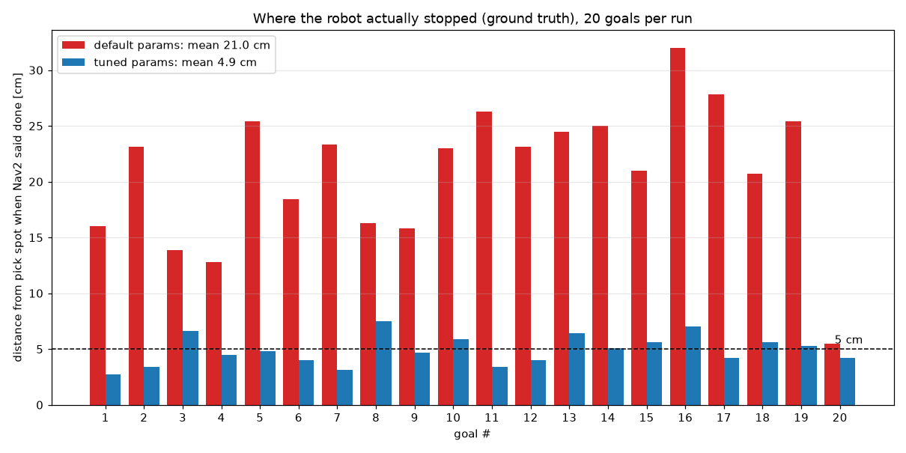
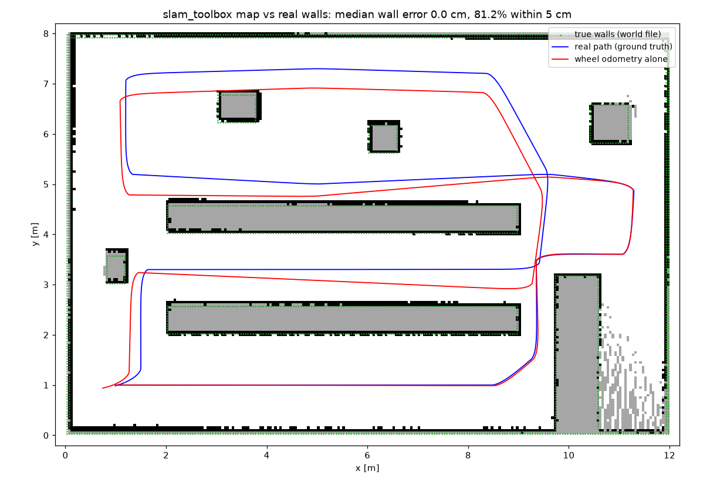

# ros2-amr-slam-nav2

A warehouse robot in ROS 2 Humble. First it maps the floor with slam_toolbox, then it uses that saved map to drive to 20 pick spots with AMCL and Nav2. I ran the 20 goals twice, once with the stock Nav2 params and once with my tuned ones, and checked where the robot actually stopped.

https://github.com/user-attachments/assets/8ffe583e-a2d2-4418-86dc-9ed654b71e16

## What it is

I don't have Gazebo on the machine I used, so I wrote a small 2D simulator for the robot (`amr_sim/sim_node.py`). It's a differential drive base with a 360 beam lidar (8 m range) that raycasts against a 12 m x 8 m warehouse grid. Wheel odometry has some noise and a 1.5% yaw scale error, so it drifts like a real base would. There's no wheel slip or real dynamics, it's kinematic only.

Everything on top of that is the real ROS 2 stack: slam_toolbox (online async) for mapping, AMCL for localization, Nav2 for planning and control, and `nav2_simple_commander` to send the goals. The sim also publishes the true pose on `/ground_truth`, which is how I measured the stop error.

## What I found

Nav2 said SUCCEEDED for all 20 goals with the default params. Then I compared with ground truth and the robot was stopping up to 32 cm away from the pick spot. 19 of the 20 stops were between 12.8 and 32 cm off.

All numbers below are from `results/metrics.json`.

| | Default params | Tuned params |
|---|---|---|
| Nav2 result SUCCEEDED | 20/20 | 20/20 |
| Mean stop error (vs ground truth) | 21.0 cm | 4.9 cm |
| Worst stop error | 32.0 cm | 7.5 cm |
| Stops within 5 cm | 0/20 | 11/20 |
| Stops within 10 cm | 1/20 | 20/20 |
| Wall contacts | 0 | 0 |
| Total time for 20 goals | 11.6 min | 13.1 min |

So the tuned run costs about 1.5 min more over the 20 goals, but every stop is within 7.5 cm.

Mapping: the robot drove 47.2 m, slam_toolbox published 76 map updates, and 81.2% of the mapped wall cells are within 5 cm of the real walls. Wheel odometry alone drifted up to 0.44 m on the same drive.




## What I changed and why

There were two problems with the defaults.

The first is the goal tolerance. `xy_goal_tolerance` is 0.25 in both the goal checker and DWB, so anything within 25 cm counts as "arrived". Nav2 wasn't lying, it was just happy with 25 cm.

The second took me longer to see. AMCL only updates after the robot moves 25 cm or turns 0.2 rad, and it only uses 60 beams. So when the robot slowed down near the goal, the pose it was trusting was often a bit old.

Changes in `config/nav2_tuned.yaml`:

- Goal tolerance 0.05 m and yaw tolerance 0.15 rad (was 0.25 / 0.25)
- AMCL `update_min_d` 0.05 and `update_min_a` 0.05 (was 0.25 / 0.2), so it updates much more often
- AMCL `max_beams` 180 (was 60), `laser_max_range` 8.0 to match the lidar, `sigma_hit` 0.05 (was 0.2)
- AMCL `alpha1` to `alpha4` 0.1 (was 0.2) and `min_particles` 1000 (was 500)
- `robot_radius` 0.20 and `inflation_radius` 0.45 (was 0.22 / 0.55). With the defaults the 0.70 m slot between the lower corridor and the middle aisle was too expensive to plan through.

## How to run it

You need ROS 2 Humble with `slam_toolbox`, `nav2_bringup` and `nav2_simple_commander`. I used a RoboStack micromamba env, so the scripts activate that. Change the first few lines of the scripts if your setup is different.

```bash
bash scripts/run_mapping.sh                          # drive the loop + map, saves results/mapping_run.npz
python3 tools/save_map.py results/mapping_run.npz maps/warehouse
bash scripts/run_nav.sh default config/nav2_default.yaml
bash scripts/run_nav.sh tuned   config/nav2_tuned.yaml
python3 tools/analyze.py                             # metrics.json + plots
```

`tools/make_video.py` builds the older demo video. The new one is made with the scripts in `tools/video_v2/` (the steps are at the top of `run_viz.sh`).

## Repo layout

| Path | What's in it |
|---|---|
| `amr_sim/sim_node.py` | my 2D diff drive simulator: `/cmd_vel` in, `/odom`, TF, `/scan`, `/ground_truth`, `/clock` out |
| `amr_sim/world.py` | the 12 m x 8 m warehouse grid (shelf rows, pallets, the 0.70 m slot) |
| `amr_sim/tour_node.py` | the mapping drive, a fixed loop instead of teleop |
| `amr_sim/goal_runner.py` | sends the 20 goals and logs result, time, path length and true stop position |
| `amr_sim/map_recorder.py` | saves every `/map` update and the poses to an npz |
| `config/` | slam_toolbox params, default and tuned Nav2 params |
| `maps/` | the map slam_toolbox built |
| `results/` | `metrics.json`, per-goal JSONs, raw logs and recorded runs |
| `scripts/` | run scripts for mapping and navigation |
| `tools/` | analysis, map saving and video scripts |
| `docs/media/` | demo videos and plots |

A note on the demo video: the navigation clip in it is a separate re-run of both configs, because the original 20-goal runs didn't record particles, paths or scans. In that clip goal 1 stopped 23.9 cm off with default params and 3.6 cm with tuned. The tables and plots all use the original runs. In the mapping part, the lidar rays are redrawn from the logged robot poses using the same lidar model as the sim.

Shanmukh Narayana Chaganti
