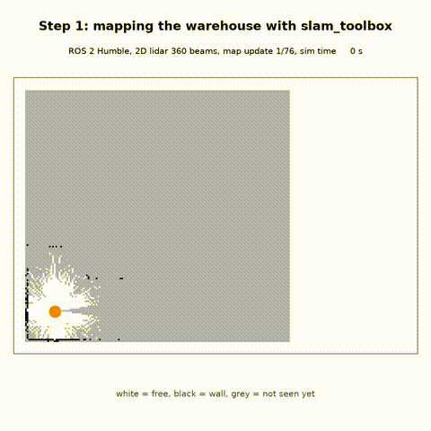

# ros2-amr-slam-nav2

Warehouse AMR in ROS 2 Humble: map the floor with **slam_toolbox** (online async), then run **AMCL + Nav2** on the saved map through 20 pick-station goals with `nav2_simple_commander`.



## What's in here

| path | what |
|---|---|
| `amr_sim/sim_node.py` | my own 2D diff-drive simulator (no Gazebo on this machine): `/cmd_vel` in, `/odom` + TF `odom->base_link`, 360-beam lidar `/scan` raycast against the warehouse grid, `/ground_truth`, `/clock` out. Wheel odom has noise and a 1.5 % yaw scale error so it drifts. |
| `amr_sim/world.py` | 12 m x 8 m warehouse: shelf rows, pallets and a 0.70 m slot between the lower corridor and the middle aisle |
| `amr_sim/tour_node.py` | mapping drive (stand-in for teleop) |
| `amr_sim/goal_runner.py` | sends the 20 goals, logs result, time, path length and where the robot really stopped |
| `config/slam.yaml` | slam_toolbox online async params |
| `config/nav2_default.yaml` / `config/nav2_tuned.yaml` | stock Nav2 Humble params vs my tuned version |
| `maps/warehouse.{pgm,yaml}` | the map slam_toolbox built |
| `results/` | raw logs, goal JSONs, `metrics.json` |
| `tools/` | analysis and video scripts |

## Results (all from `results/metrics.json`)

| | default Nav2 params | tuned |
|---|---|---|
| Nav2 result SUCCEEDED | 20/20 | 20/20 |
| mean distance from pick spot (ground truth) | 21.0 cm | 4.9 cm |
| worst | 32.0 cm | 7.5 cm |
| stops within 5 cm | 0/20 | 11/20 |
| wall contacts | 0 | 0 |
| total time | 11.6 min | 13.1 min |

Mapping: 47.2 m drive, 76 map updates, 81.2 % of mapped wall cells within 5 cm of the real walls. Wheel odometry alone drifted up to 0.44 m over the same drive.


## What was wrong with the defaults

Nav2 reported every goal as SUCCEEDED, but the robot was stopping 13 to 32 cm away from the pick spot. Two reasons:
1. `xy_goal_tolerance: 0.25` in both the goal checker and DWB: anything within 25 cm counts as done.
2. AMCL only updated after 25 cm / 0.2 rad of motion and used 60 beams, so the pose it ended on was often stale.

Changes in `nav2_tuned.yaml`: goal tolerance 0.05 m / 0.15 rad, AMCL `update_min_d 0.05`, `update_min_a 0.05`, `max_beams 180`, `laser_max_range 8.0`, `sigma_hit 0.05`, `alpha1-4 0.1`, `min_particles 1000`, and `robot_radius 0.20` + `inflation_radius 0.45` so the 0.70 m slot stays cheap enough to plan through. Cost: about 1.5 min more over the 20 goals.

## Run it

Needs ROS 2 Humble with `slam_toolbox`, `nav2_bringup`, `nav2_simple_commander` (I used a RoboStack micromamba env).

```bash
bash scripts/run_mapping.sh                       # drive + map -> results/mapping_run.npz
python3 tools/save_map.py results/mapping_run.npz maps/warehouse
bash scripts/run_nav.sh default config/nav2_default.yaml
bash scripts/run_nav.sh tuned   config/nav2_tuned.yaml
python3 tools/analyze.py && python3 tools/make_video.py
```

Note: the simulator is a simple 2D one I wrote, not Gazebo, so there's no wheel slip or dynamics beyond a kinematic diff drive. slam_toolbox, AMCL and Nav2 are the real packages.

Shanmukh Narayana Chaganti
